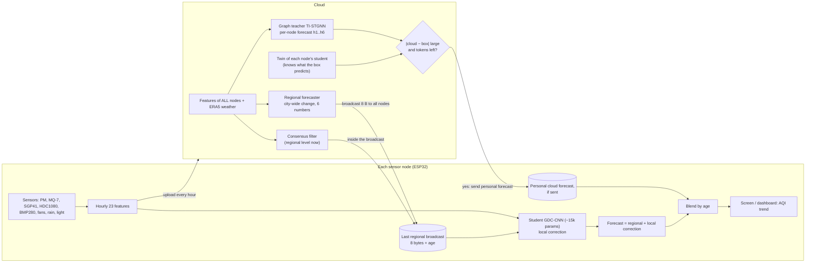

# Architecture v2: a node-network AQI forecaster for Delhi (cloud graph teacher + regional broadcast + on-device local model)

> **Naming note:** this file describes version 1, where the big cloud graph model was called the "teacher" and the on-device model the "student". The current design (v3) is in `docs/ARCH_V3.md`; it no longer treats the box model as a copy of the cloud model.

> **Superseded by `docs/ARCH_V3.md` (17 Nov 2026).** v3 adds node memory (E8) and corrects the "no-regret" claim
> for the full split model (E9). This file is kept for history.

Version 2, 15 Nov 2026. One file that explains the whole system end to end: what the nodes do, what the cloud does,
what is new, what was tested, what failed, and what comes next. Plain words first, formulas after.

> **Status, read this first.** Every number in this file comes from **simulated sensor boxes** (`simulator.py`)
> driven by real CPCB station data (2018 - Sep 2026) and real ERA5 weather. No real box has been deployed yet.
> The numbers are evidence that the design is worth building, not final paper results. Real-node checks are in
> Section 13.

---

## 0. The idea in one minute

- We put low-cost sensor boxes (ESP32 + PM, gas and weather sensors) around Delhi. Each box forecasts how PM2.5 and
  PM10 (and so the CPCB AQI) will change in the next 1-3 hours.
- **v1** (built): a big **cloud teacher** (a graph neural network over all stations) teaches a tiny **student**
  that runs alone on the box (knowledge distillation). Finding: the teacher is much better (skill 20.8 vs 15.0)
  because it **sees the other nodes**, and distillation cannot pass that information into a box that sees only itself.
- **v2** (this file): stop pretending the box is alone. The **nodes are a network**:
  1. Every node uploads its hourly sensor features. The cloud uses **all nodes together** to forecast the
     **shared, city-wide change** and broadcasts it to every box in **8 bytes**.
  2. The box's tiny model then only has to predict **its own local difference** (traffic, burning, dust near it)
     on top of that broadcast.
  3. When the cloud and the box disagree strongly, the cloud also sends that box its full **personal** graph forecast.
     It only sends when it matters, so about 20 % of the messages keep about 2/3 of the gain.
  4. If the link is down, the box still forecasts alone (no harm), and a 1-hour-old broadcast still helps.
- Result on simulated nodes: the on-device forecast improves from skill **16.0 to 17.7** at known places and from
  **17.5 to 19.9** at **new places** (95 % confidence interval well away from zero). That makes it the biggest
  accuracy gain we have found for the box.

---

## 1. Problem and goal

| | |
|---|---|
| **Forecast** | change of PM2.5 and PM10 at +1, +2, +3 h for each box (the cloud teacher does +1..+6 h) |
| **Target** | `y = ln(1+PM[t+h]) − ln(1+PM[t])` of the **true** CPCB PM; order `[pm25_h1..h3, pm10_h1..h3]` |
| **Why the change, not the level** | the box's own PM sensor is biased (humidity, calibration). The change is easier to learn and the level comes from the box's calibrated sensor (or the cloud). |
| **Score** | **skill** = `1 − RMSE / RMSE(persistence)` in %, where persistence = "PM stays the same". 0 = no better than the lazy guess, higher is better. Also direction accuracy (up/down right) and CPCB category accuracy. |
| **Where** | Delhi-NCR, 32 CPCB stations used as node places (27 for training, **5 never seen** to test new places) |
| **When** | train 2018-2023, validation 2024, test Jan 2025 - Sep 2026 (time split, no leakage) |

**Research question (v2):** how much better can a tiny on-device forecaster get when the nodes share a few
bytes per hour through the cloud, and how gracefully does it fall back when the link fails?

---

## 2. The whole system at a glance



Without Mermaid:

```
 node i: sensors -> 23 features --upload--> CLOUD: all nodes + weather
                                              |-> graph teacher (per node, h1..h6)
                                              |-> regional forecaster (6 numbers, same for all)
                                              |-> regional level now (consensus)
          <-- 8-byte broadcast (every hour, to everyone) --|
          <-- personal forecast (only when cloud and box disagree) --|
 node i: student(own 24 h + broadcast) = regional + local correction
         show: fresh personal forecast > blend(stale personal, box) > box alone
```

---

## 3. The nodes, and why they matter

### 3.1 Hardware (fixed sensor pool)

| part | measures | used for |
|---|---|---|
| ESP32-WROOM-32 DevKit now (ESP32-S3 later) | runs the student, Wi-Fi | model + upload |
| PMS7003 now / SPS30 later | PM1, PM2.5, PM10 | main signal |
| MQ-7 | CO (traffic) | **most useful extra sensor** |
| SGP41 | VOC / NOx index | small help |
| HDC1080 | temperature, humidity | humidity correction of PM, context |
| BMP280 | pressure | small help |
| 2 perpendicular fans + hall sensors | wind speed along 2 axes (\|u\|, \|v\|) | **useful** (local mixing) |
| rain plate, BH1750 light, MQ-135 | rain 0/1, light, air quality | add nothing measurable (see 9.6) |
| DS3231 | real-time clock | hour stamps |

### 3.2 What a node does every hour

1. Average its sensors over the hour → **23 features**: ln PM2.5 / PM10 / PM1, coarse ratio, T, RH, p, fan wind
   u / v, rain fraction, ln light, MQ-7 / MQ-135 / VOC / NOx (relative to their clean-air baseline), hour / weekday
   / day-of-year as sin / cos, current AQI, PM-valid mask. (Code: `firmware/aqi_node/features.h`, checked against
   the notebooks by `firmware/check_features.py`.)
2. **Upload** the hourly record to the cloud (if online).
3. Run the student on the last 24 h + the latest regional broadcast → forecast for +1..+3 h.
4. Show the best forecast available (Section 6.4).

### 3.3 Why the nodes are essential in v2 (not just "sensors for a cloud model")

| what the node gives | why the cloud cannot do it alone | evidence |
|---|---|---|
| **Its upload is the network.** The cloud's graph and regional forecast are built only from node features. There is no other PM input (rule in 4.3). | Without nodes there is no network to learn from | graph of other nodes: **−2.6 % error** for the teacher (9.1) |
| **Real-time local state** (own PM, CO from traffic, humidity, local wind) | a box's PM is typically about **2× above or below** the city average because of traffic, burning and dust. Only the box sees this right now. | regional forecast alone: skill **11.1**; plus the box's local model: **17.7** (9.3) |
| **Works offline** | the cloud is unreachable during outages | student alone = no-harm fallback (9.4) |
| **Its own forecast** tells the cloud when a personal message is worth sending | the cloud runs a twin of the student, so it knows what the box will show | disagreement sending beats random by 3-4 skill points (9.5) |
| **New places** | a new box gets the regional broadcast from day 1 | unseen stations gain the most: **17.5 → 19.9** |

The more nodes there are, the better the regional estimate gets. The node-count effect is **not tested yet**
(13, step 4).

---

## 4. Data, simulator and rules (kept from v1)

### 4.1 Data
- **Truth:** official CPCB hourly files, 33 Delhi-NCR stations, Jan 2018 - Sep 2026; 32 used (one has no PM10).
  Cleaning: range limits, 6-h flat lines, Hampel filter for short glitches. Times = IST clock hours, `ts` = UTC
  instant of the IST hour start.
- **Weather:** Open-Meteo ERA5 (temperature, humidity, pressure, wind u / v, rain, sunlight), requested in GMT.
- **Measured CPCB wind** (WS / WD columns) was extracted only for the wind re-test (`experiments/build_wind_cpcb.py`).

### 4.2 Simulator (because there are no real boxes yet)
- `simulator.py`: `simulate(X, station, unit) -> Y`. True air + weather of a station → what one ESP32 box would
  read, with one physics / datasheet function per sensor. There are **3 virtual units per station** (96 boxes),
  each with its own bias, gain, drift, missing hours and outages.
- The PMS7003 simulation has slope 2.19 vs the truth and R² 0.61 (TODO_VERIFY by co-location).

### 4.3 Hard rules (research correctness)
1. **True CPCB PM is a target only, never an input.** The teacher, the regional forecaster and the student all
   get **only simulated node features** (+ weather for the cloud). Distillation and broadcasting therefore move
   *network knowledge*, not "clean data".
2. **No future leakage.** Inputs use hours ≤ t. Anything one model produces for another model's training (teacher
   outputs, regional forecasts) is **out-of-fold**: made by a model that did not train on those hours.
3. The 5 hold-out stations are never trained on.

---

## 5. The cloud side

### 5.1 Graph teacher TI-STGNN (from v1, kept)

**What:** a PyTorch model (~0.2 M parameters) that sees all nodes' last 24 h and forecasts each node's change
for +1..+6 h, with a 10-90 % uncertainty band.

**Blocks (fixed order):**
1. **Transformer over time**, one station at a time: reads the 24 h of 23 features.
2. **Wind-aware graph attention (GAT)** between stations, with a physical prior added to the attention scores:
   `prior(j→i) = ReLU(ws · cos(bearing_ji − wind_to)) / dist_ji`, used as `β · log(prior)`.
   The v1 contribution here was a **direction fix of TransNet**: TransNet uses the direction the wind comes FROM,
   which points the prior upwind. We use the direction it blows TO, and the edge *from* the neighbour, so a station
   listens to its upwind neighbours, not its downwind ones.
3. **ADR physics block** (advection-diffusion-reaction): advection re-uses the attention scores normalised per
   sender (mass conserved); diffusion runs on a fixed distance graph (exact step by eigen-decomposition);
   reaction is a small local network. Step h = 0.1, 2 steps.
4. **Decoder** with the next 6 h of weather. This is a **hindcast**, because ERA5 actuals were used: archived
   forecasts don't exist for 2018-23.

**Variants:** T0 (own station only), T1 (+ graph), T2 (+ wind prior), T3 (+ ADR).
**What survived testing (9.1):** the **graph** is the useful part. Wind prior and ADR add ≤ 0.2 % (noise level).
**v2 decision:** the live cloud uses **T1** (graph, no wind prior, no ADR): same accuracy, simpler. T2 / T3 stay
in the paper as ablations and as an honest negative result.

### 5.2 Regional forecaster (NEW in v2)

**What:** one small model for the whole city that forecasts the **city-wide mean change** of PM2.5 and PM10 at
+1..+3 h (6 numbers), the same for every node.

**Inputs (hour t and before, all from nodes + public weather):**
- regional mean of the nodes' own ln PM2.5 and ln PM10: `R(t) = mean_i S_i(t)`, at lags 0, 1, 2, 3, 6, 12, 23 h, and
  its 1-h and 3-h changes;
- regional mean of the nodes' RH, T, MQ-7 and fan wind;
- city-mean ERA5 weather (7 channels); clock (hour, weekday, day of year as sin / cos).

**Target:** mean over nodes of the true change (target only, rule 4.3.1).
**Model tested:** LightGBM, 6 outputs, **out-of-fold over year blocks** (2018-19, 2020-21, 2022-23), so the
student is trained on regional forecasts that never saw those hours.
**Planned option:** use the mean of the GNN teacher's per-node forecasts as the regional forecast instead. This
ties v2 to the graph teacher, and the combined run (13, step 1) picks whichever wins on validation.

**Why a regional model works:** Delhi behaves as **one airshed**. Clustering the stations by how their 3-h changes
correlate gave one big cluster of 28 stations plus 4 singletons (correlation within 0.33, between 0.10). Averaging
many noisy boxes cancels each box's sensor noise, so the city-wide change is easy for the cloud to forecast and
hard for any single box.

### 5.3 Consensus filter (NEW, from sensor-network consensus)

Each node's level is re-estimated as "the region now + this node's usual offset from the region":

`d_i(t) = R(t) + EWMA_{half-life 24 h}( S_i − R )(t−1)`

This removes short sensor noise from the box's level while keeping its persistent local offset. The box gets
`d_i − S_i` and the 1-h / 3-h slopes of `d_i`. Alone it gives **−0.9 % error** (9.3). It is not yet combined
with the split design (13, step 1).

### 5.4 Personal forecasts with event-triggered sending (NEW, from networking)

The cloud keeps a **twin** of each node's student and runs it on the uploaded features, so it knows the box's
forecast without asking. This is the "dual prediction" idea from sensor networks. Each hour it sends a node its
personal T1 forecast **only if**:
- the disagreement `|cloud − box|` is among the largest (send-on-delta), and
- the node still has tokens left (**token bucket**: a fixed number of messages per day, like router rate-limiting).

This spends messages where the box is most wrong. Result (9.5): at 20 % of hours it keeps ~66 % of the gain,
versus ~19 % when sending at random.

### 5.5 Message budget

| message | direction | size | when |
|---|---|---|---|
| hourly feature record | node → cloud | one record of the 23 features | every hour (if online) |
| **regional broadcast** | cloud → all nodes | **8 bytes** = 6 regional forecasts (int8) + 2 regional levels now (int8), + 1 sequence/age byte | every hour, one message for everyone |
| personal forecast | cloud → one node | 12 bytes (6 outputs × int16) + band if wanted | only when triggered (e.g. ≤ 4-6 per day) |

8-bit quantisation of the regional mean was tested and is identical to float (9.4). 8-bit quantisation of the
6 forecasts follows the same scale but is **not yet tested** (13, step 1).

---

## 6. The edge side (the box)

### 6.1 Student network: GDC-CNN (from v1)

- Based on Na et al.: the last 24 h are cut into **12 patches of 2 h**, with **instance normalisation** (the
  window's own level and scale are removed and kept as `s`), a position code, and **3 gated dilated depthwise
  convolution blocks** (dilation 1, 2, 4), width 32.
- ~14-15k parameters, Keras → TFLite FP32, a few tens of KB. It runs once an hour, so compute is not a problem.
- **Context input ("ctx", added in the experiments):** the raw current values that instance norm throws away
  (ln PM2.5, RH, T, MQ-7, hour, season, wind speed) go in through a small dense layer. Gain −0.5 % error (9.2).

### 6.2 What changes in v2: split output (regional + local correction)

```
inputs : own 24 h (12 patches) + ctx + broadcast [R̂_1..6, R25(t) − own25(t), R10(t) − own10(t)]
body   : GDC-CNN as before, broadcast through its own small dense layer, all joined before the head
output : ŷ = R̂ + s · Dense6(features)      # regional forecast + the box's local correction
```

- `R̂` = the 6 regional forecasts from the broadcast; `s` = instance-norm scale.
- The box learns **only the local difference**. Its few parameters go to what only it can see, not to
  re-learning the city-wide pattern from one noisy sensor. This is the same trick as **common-mode rejection** in
  electronics: subtract what everyone shares, then amplify only what is yours.
- Honest note: most of the gain comes from **giving the box the broadcast** at all (split as input: −1.43 %).
  Making the output explicitly "regional + correction" adds a further −0.16 %, which is **not significant** on its
  own (CI −0.37 to +0.06). We keep the residual form because it is more interpretable and degrades sensibly, and
  we report both.

### 6.3 Robustness: missing and stale broadcasts

- Training randomly makes the broadcast **0-3 h old** and **missing 20 % of the time** (missing = zeros + flag).
- Result (9.4, tested for the 1-byte regional mean): fresh helps (−0.7 %), 1 h old still helps (−0.2 %),
  2-3 h old or missing is **no worse than no broadcast** (differences within ±0.1 %, CI crosses 0). So the
  broadcast is no-regret.
- The same dropout training still has to be applied to the full split model (13, step 1).

### 6.4 What the screen shows (fusion rule)

| situation | shown forecast | skill (test) |
|---|---|---|
| fresh personal cloud forecast (age 0) | cloud | 23.5 |
| personal forecast 1 h old | fixed blend α·cloud + (1−α)·box, α = 0.52 | 19.4 (box 15.9, stale cloud alone 16.8) |
| 2 h old | blend, α = 0.41 | 18.3 |
| 3 h old | blend, α = 0.36 | 17.8 |
| no cloud | box (v2 split student with broadcast, or alone) | 15.7 - 17.7 |

- **Re-basing rule (important):** an h-hours-old forecast must be moved to "now" using **its own forecast path**
  (`old_forecast − old_forecast[age]`), **not** the box's noisy current sensor reading. Re-basing on the sensor
  gave skill −71 % (worse than doing nothing), while path re-basing works. We keep the sensor re-base as the
  negative control.
- The blend weights α are fixed per age, fitted on 2024. Online-adaptive weights (Bates-Granger, or a
  Jacobson / TCP-RTT-style estimator) were tried and are **not better** (9.5).

---

## 7. Training pipeline (where each part is trained)

| step | where | what |
|---|---|---|
| `notebooks/01_data` | laptop | CPCB + Open-Meteo → clean hourly tables |
| `notebooks/02_simulator` | laptop | `simulator.py`: 3 virtual boxes per station |
| `notebooks/03_dataset` | laptop | 23 features, targets, windows, teacher grids `grid_u{0,1,2}.npz` |
| `notebooks/04_train` Part A | Kaggle GPU | teacher T0-T3, ablations, **out-of-fold** teacher outputs |
| `notebooks/04_train` Part B | Kaggle GPU | student S0-S4 (distillation), sensor ablation, TFLite export |
| v2 additions (now in `experiments/exp_*.py`) | Kaggle CPU | regional forecaster (OOF), consensus filter, split student, fusion |

Distillation (v1) stays as the way to train the box's model: S1 / S2 (copy the teacher's forecast, plus its time
features and attention) gave +0.9 skill over S0. In v2 the student is trained with **both** the teacher's soft
targets and the broadcast input. Whether KD still adds on top of the broadcast is an open check (13, step 1).

---

## 8. Novelty: what is new, and how strongly we can claim it

### 8.1 From v1 (the original architecture)

| # | idea | status after testing |
|---|---|---|
| v1-1 | Cloud graph teacher → MCU student distillation for AQI (TI-STGNN → GDC-CNN) | works but small: +0.9 skill; the student keeps only 12-24 % of the teacher's advantage. **Kept as a baseline / training method, not the headline.** |
| v1-2 | **Fair distillation**: teacher and student get the identical simulated node features; true PM only as the target | **Kept.** It makes the result honest: the gain is network knowledge, not cleaner data. |
| v1-3 | Wind-direction fix of the TransNet prior (blows-TO, edge from the neighbour) | correct physics, but **no measurable gain** (9.1). Report it as a fix plus a negative result. |
| v1-4 | ADR physics block (mass-conserving advection on attention, exact diffusion) | **≤ 0.2 %**, noise level. Negative result. |
| v1-5 | Distilling spatial / physics states (S3, S4) into a single-station student | **makes it worse.** Negative result: you can't imitate information you can't see. |
| v1-6 | Out-of-fold teacher outputs + full benchmarks + seen / unseen stations | **Kept** (method quality, not novelty). |

### 8.2 New in v2 (this chat's experiments)

| # | idea | inspired by | result | claim |
|---|---|---|---|---|
| **N1** | **Split cloud-edge forecaster**: the cloud broadcasts the city-wide change (8 B), and the box predicts only its local difference | common-mode rejection; hierarchical forecasting | **−1.58 % error** (CI −1.90 to −1.27); skill 16.0 → 17.7 seen, 17.5 → 19.9 unseen; direction accuracy 69.8 → 71.3 % | **main contribution** |
| N2 | **Consensus filter** for the box's level | consensus / average filters in sensor networks | −0.90 % (CI −1.05 to −0.74) | supporting; combine with N1 |
| N3 | **Byte-level regional context** with dropout and staleness training (1 byte is enough; 8-bit = float) | rate-distortion (contribution.md C-A) | −0.71 % fresh, −0.20 % at 1 h, no harm when missing | supporting: shows **no-regret** behaviour |
| N4 | **Event-triggered personal forecasts** + token bucket; cloud runs a twin of the student | send-on-delta, dual prediction, router rate limiting | at 20 % of hours: 20.7 vs random 17.1 (box 15.7, always-send 23.3), ~66 % of the gain | supporting: the bandwidth / accuracy trade-off curve |
| N5 | **Stale-forecast re-basing on its own path**, plus a fixed blend by age | forecast combination (Bates-Granger) | sensor re-base −71 %; path re-base + blend 19.4 at 1 h | a design rule (small but useful) |
| N6 | **Placebo-controlled wind test** (180°-rotated wind, measured vs ERA5 wind, 3 seeds, by wind-speed bin) | experimental control | wind direction adds nothing measurable at 1-3 h in Delhi | an **honest negative result**, publishable as such |
| N7 | **Sensor value per watt** (all 128 sensor subsets vs power) | Pareto / design-space search | fans and MQ-7 are worth it; MQ-135 adds ~0 for ~0.8 W (TODO_VERIFY power) | a design rule |

**The single sentence for the paper:** *"A split cloud-edge forecaster: the cloud uses all nodes to predict the
shared regional change in a few bytes, and the on-device model predicts only the local difference. It improves the
on-device forecast by 1.6 % RMSE (more at new sites), is no-regret when the link fails, and a disagreement-triggered
personal forecast recovers two thirds of the full cloud model's gain at one fifth of the messages."*

### 8.3 What we do NOT claim (prior art exists)

- "Global model + local residual" in general: hierarchical / multi-level forecasting, and model output statistics
  (MOS) style corrections, are old ideas. Our delta: **low-cost AQI nodes, a byte-sized broadcast, an MCU model,
  measured no-regret behaviour, and a Delhi evaluation at seen and new sites.**
- Dual prediction / send-on-delta in sensor networks, consensus filters, gossip, token bucket and forecast
  combination are all known. We **apply and measure** them for AQI; we did not invent them.
- Cloud context sent to an edge model exists in other domains (e.g. cloud-assisted edge PV forecasting, and
  collaborative edge learning for air pollution, Wardana et al. 2024). See `contribution.md` §3.1.
- That the box is "local-only" (false once the broadcast is used).
- Wind / ADR / fuzzy / custom losses as improvements (they did not improve, Section 10).

**A literature check is required before any "first" wording** (13, step 2).

---

## 9. Evidence (all simulated nodes, test period 2025 - Sep 2026)

How to read: **% error** = change in RMSE vs the reference arm (negative = better). The **CI** is a 95 %
week-block paired bootstrap; if it contains 0, there is no real difference. Skill values are means over 3 seeds
unless noted. Different experiments use different test samples, so compare numbers **within** a table, not across
tables.

### 9.1 Teacher: what helps the graph model (wind re-test, `exp_wind.py`, Kaggle GPU)

| teacher | skill 1-6 h (seen) |
|---|---|
| T0 own station, no weather | 22.82 |
| T0 own station, past weather only | 23.01 |
| T0 own station, + future weather (hindcast) | 23.99 |
| **T1 + graph of other nodes** | **25.97** |
| T2 + ERA5 wind prior | 26.11 |
| T2 + measured CPCB wind | 26.00 |
| T2 + wind rotated 180° (**placebo**) | 25.95 |

| comparison | % error | 95 % CI |
|---|---|---|
| **graph vs no graph (T1 vs T0)** | **−2.60** | −2.93 to −2.27 |
| future weather vs none (hindcast) | −1.27 | −1.61 to −0.94 |
| past weather vs none | −0.25 | −0.54 to +0.05 |
| ERA5 wind vs no wind (T2 vs T1) | −0.19 | −0.40 to +0.03 |
| ERA5 wind vs **placebo** wind | −0.21 | −0.43 to +0.01 |
| CPCB measured wind vs no wind | −0.04 | −0.24 to +0.15 |

The learned weight β of the wind prior stays near 0 (0.06-0.09) and goes slightly negative for the placebo.
The v1 run agrees: T0 21.7 → T1 23.6 → T2 23.6 → T3 23.8. A separate LightGBM probe (`exp_probe.py`) agrees too:
distance-weighted neighbours −1.0 % at +1 h (CI −1.59 to −0.42); upwind vs placebo-downwind ≈ 0; a wind-transport
kernel tuned by **differential evolution** (`w = d^−p · exp(κ · cos · min(ws/ws0, 1))`) found κ ≈ 0.69 but gained
only ~0.06 %.

### 9.2 Student: what helps the box alone (`exp_student.py`)

| student | skill seen | skill unseen | params |
|---|---|---|---|
| S0 (GDC-CNN) | 15.64 ± 0.04 | 17.16 | 14,278 |
| **S0 + ctx** | **16.02 ± 0.12** | **17.49** | 14,790 |
| FZ (fuzzy Takagi-Sugeno gate, 4 rules) | 15.89 | 17.34 | 21,280 |
| S0 + weather now / past | 15.57 | 17.30 | |
| S0 + weather forecast | 14.85 ± 0.77 | 16.52 | |

ctx vs S0: −0.49 % (CI −0.63 to −0.36). Fuzzy = ctx (+0.02 %, CI crosses 0), but readable: its strongest rule
is "winter, humid, high PM, high CO". Weather inputs don't help the box.

### 9.3 Split architecture: the main result (`exp_split.py`)

| arm | skill seen | skill unseen | direction acc. | category acc. |
|---|---|---|---|---|
| ctx (box alone, reference) | 16.01 | 17.48 | 69.8 % | 70.7 % |
| + consensus filter | 16.83 | 18.56 | 70.4 % | 71.0 % |
| + regional broadcast as input (split) | 17.46 | 19.34 | 71.0 % | 71.1 % |
| **split-res (regional + local correction)** | **17.73** | **19.92** | **71.3 %** | **71.0 %** |
| custom trend-hinge loss | 15.62 | 16.93 | 69.6 % | 70.9 % |
| custom AQI-breakpoint loss | 15.59 | 16.97 | 69.6 % | 70.5 % |
| regional forecast only, no box model | 11.06 | 14.44 | 67.3 % | 69.8 % |

| comparison vs ctx | % error | 95 % CI |
|---|---|---|
| **split-res** | **−1.58** | −1.90 to −1.27 |
| split | −1.43 | −1.72 to −1.14 |
| consensus filter | −0.90 | −1.05 to −0.74 |
| trend loss | +0.64 (worse) | +0.41 to +0.87 |
| AQI loss | +0.38 (worse) | +0.22 to +0.54 |
| split-res vs split | −0.16 | −0.37 to +0.06 (not significant) |

**Reading:** the regional forecast alone (11.1) is weak for any single box, and the box alone (16.0) misses the
city-wide part. Together they give 17.7, and the gain is largest at new stations (+2.4 skill).

### 9.4 Regional context bytes, staleness and gossip (`exp_netctx.py`)

| context given to the box | fresh | 1 h old | 2 h old | 3 h old | missing |
|---|---|---|---|---|---|
| regional mean, float | −0.71 % | −0.21 % | +0.01 % | +0.09 % | +0.10 % |
| **regional mean, 8-bit (1 byte)** | **−0.71 %** | −0.20 % | +0.01 % | +0.09 % | +0.10 % |
| per-cluster mean, 8-bit | −0.70 % | −0.27 % | −0.02 % | +0.10 % | +0.09 % |
| gossip between nearby boxes (no cloud) | −0.33 % | −0.10 % | +0.03 % | +0.13 % | +0.06 % |

(% error vs ctx; fresh and 1-h values are significant, the stale / missing ones are within noise except gossip at 3 h.)
- 8 bits are enough. Per-cluster equals Delhi-wide because the city is one airshed.
- **Gossip** (push-sum averaging between boxes within 10 km, 20 rounds, 20 % packet loss) gets to error 0.32 vs
  the city mean (a box's own reading alone: 0.69) and gives **about half** of the cloud's gain. It is a possible
  cloud-free fallback, not the main path.

### 9.5 Cloud-box fusion and messaging (`exp_fusion.py`)

Box alone 15.66; personal cloud forecast every hour 23.30.

| % of hours a personal forecast is sent | disagreement-triggered | random | oracle (upper bound) |
|---|---|---|---|
| 5 % | 18.10 | 16.01 | 21.68 |
| 10 % | 19.31 | 16.42 | 24.25 |
| **20 %** | **20.72** | 17.10 | 27.19 |
| 30 % | 21.65 | 17.90 | 28.77 |
| 50 % | 22.63 | 19.41 | 30.01 |

Token bucket (messages allowed per node per day):

| budget / day | disagreement | periodic |
|---|---|---|
| 1 | 16.51 | 15.84 |
| 2 | 17.33 | 16.20 |
| 4 | **18.26** | 16.60 |
| 6 | 19.02 | 16.89 |
| 12 | 20.86 | 20.00 |

Stale personal forecasts (age in hours), skill:

| age | box | cloud (path re-base) | fixed blend | online Bates-Granger | online Jacobson |
|---|---|---|---|---|---|
| 0 | 15.87 | 23.53 | 23.83 | 22.55 | 22.44 |
| 1 | 15.87 | 16.79 | **19.42** | 19.44 | 19.32 |
| 2 | 15.87 | 14.20 | **18.29** | 18.33 | 18.19 |
| 3 | 15.87 | 13.01 | **17.81** | 17.77 | 17.63 |

### 9.6 Sensors vs power (`exp_probe.py`, LightGBM, all 128 sensor subsets; power TODO_VERIFY)

| best set at this power | power (W) | skill |
|---|---|---|
| core only (PM + T/RH + clock) | 0.55 | 17.74 |
| + fans | 0.56 | 18.42 |
| + fans, BMP280, SGP41, rain, light | 0.58 | 18.84 |
| + MQ-7 | 0.93 | 19.17 |
| + MQ-135 | 1.73 | 19.22 |

Fans are the best value; MQ-7 adds +0.3 for +0.35 W; **MQ-135 adds +0.04 for +0.8 W**. The v1 sensor ablation
agrees (removing MQ-7: −0.45, fans: −0.26, MQ-135: −0.02).

---

## 10. Negative results (report them, they save other people time)

| tried | result | why (our reading) |
|---|---|---|
| wind direction in the graph (ERA5, measured CPCB, DE-tuned kernel) | ≈ 0, same as a 180° placebo | see Section 11 |
| ADR physics block | ≤ 0.2 % | same reason as wind; the graph learns "who matters" from data |
| distilling spatial / physics states (S3, S4) | worse than S1 / S2 | the box can't imitate what it can't see |
| fuzzy Takagi-Sugeno gate (ANFIS-like) | = plain context input | the network already learns the regimes; its value is interpretability only |
| genetic / evolutionary search | not needed | the search spaces were small enough to test exhaustively (128 sensor sets) or tune with DE |
| weather inputs on the box | no gain or worse | the box's own T / RH / fans already carry it; ERA5 is coarse |
| custom losses (trend hinge, AQI-breakpoint weighting) | worse (+0.4 to +0.6 %) | they pull the model away from the plain error it is scored on; direction accuracy didn't improve either |
| online-adaptive blend weights (Bates-Granger, Jacobson) | = fixed blend when stale, worse when fresh | the sensor noise makes the online error estimate jumpy |
| re-basing stale forecasts on the box's sensor | −71 % | the sensor noise at one hour is larger than the forecast signal |
| gossip instead of the cloud | half the gain | fine as a fallback only |
| per-cluster context | = city-wide | Delhi is one airshed (one big cluster) |

---

## 11. Why wind does not help (and where its information already is)

Wind obviously moves pollution, so why no gain? Our explanation:

1. **The wind input is too coarse.** ERA5 has only **4 distinct wind series for all 32 stations** (the median
   direction spread between stations is 4°). It says the same thing everywhere, so it cannot tell stations apart.
2. **Measured station wind is too noisy.** CPCB vanes disagree by a median of 70° between stations; several
   stations have almost no wind data; vanes sit near buildings.
3. **The signal is mostly city-wide.** Delhi PM moves up and down together (one airshed: inversion at night,
   season, stubble smoke), and the graph already captures that common part without needing wind.
4. **The physics doesn't fit the horizon.** Stations are 5-15 km apart. At typical Delhi winter winds of 0-2 m/s,
   air needs 1-4 hours to travel between them, and in calm nights (when PM is highest) it barely moves. So at
   +1..+3 h, "upwind" is often not yet informative or simply undefined.
5. **Its information is already elsewhere.** Wind **speed** is already used (ERA5 u / v, and the box's fans:
   removing the fans hurts by −0.26). Calm air shows up as rising PM and humidity at night, which the time-of-day,
   season and neighbour-PM inputs already encode.

So wind is not useless. It is **already absorbed** by other inputs, and its **direction** adds nothing at this
spacing and horizon. A dense node network (≤ 2 km spacing) or longer horizons (6-24 h) might change this, which is
a future test.

---

## 12. How v2 relates to `contribution.md` (pre-experiment draft v2)

| idea there | verdict | why |
|---|---|---|
| **C-A** cloud-context bytes for an MCU student (rate-distortion, outage map) | **keep, reframed around N1** | the byte context works and is no-regret (9.4). But the H0 gate (graph ≥ 5 % better) **fails in simulation (2.6 %)**, so per its own rule the headline is the split design + bytes, not "graph teacher distillation". |
| **C-B** dry-reference labels for humid nights | **later** | needs a real box co-located with a CPCB station; can't be tested on simulated sensors |
| **C-C** burst-spread SPS30 sampling | **drop for now** | the node is mains/USB powered and the MQ heaters dominate power; it only matters for battery nodes |
| conformal intervals with a cloud hint | optional | nice extra, not core |
| RLS output head | no | old idea (Kalman / MOS bias correction); risk of hiding drift |
| feature / attention KD | baseline only | v1 shows a small gain (+0.9); spatial-state KD hurts |

---

## 13. Next steps (in order, with kill thresholds fixed now)

1. **Combined run (Kaggle CPU, ~3 h).** split-res + consensus filter + 8-bit broadcast + dropout / stale training
   + KD soft targets; regional source = LightGBM vs mean of the GNN (T1) forecasts.
   *Keep N1 if:* the combined model beats ctx by ≥ 1.5 % with a CI excluding 0, and missing / 2-h-stale is within
   +0.5 % of ctx.
2. **Literature check (1-2 days):** hierarchical / residual forecasting with low-cost sensors, dual prediction
   schemes, cloud-to-edge context for air quality, split computing. Write the exact "delta vs prior art" table.
3. **Write-up:** turn Sections 8-11 into the paper's method, results and negative results.
4. **Node-count test (CPU):** build the broadcast from 5, 10, 15 and 27 nodes. How many nodes does a city need?
   *Prediction:* the gain stays at least half of the full gain with 10 nodes.
5. **Real nodes (most important for reviewers):** co-locate 1-2 boxes with a CPCB station for 2-4 weeks. This
   (a) calibrates the PM level (v1 Finding 6: AQI colour is right only 43 % of the time without it), (b) checks
   the simulator, (c) re-tests N1 on real readings, and (d) enables C-B.
6. **Build the cloud endpoint** in `backend/`: hourly upload, regional forecaster, T1 teacher with live
   Open-Meteo forecasts (not ERA5 actuals), broadcast, and the twin-student trigger. Firmware: `cloud.cpp`
   receives the 8-byte broadcast, and `features.h` gets the new inputs.

---

## 14. Limitations (say these in the paper)

- **Simulated sensors.** The sensor simulator decides how informative each sensor is. All numbers need real-node
  confirmation.
- **Hindcast weather.** The teacher was trained and tested with real future weather (ERA5 actuals). Live forecasts
  are worse (expect about −1 point on average, up to −3 at +6 h).
- **Nodes = CPCB station places.** The simulated network sits where the CPCB stations are (5-15 km apart). A real
  network may be denser or sparser.
- **The broadcast needs enough nodes.** It was tested with 27 nodes; fewer is untested (13, step 4).
- **Not tested yet:** 8-bit quantisation of the 6 regional forecasts, dropout training of the full split model,
  and the GNN as the regional source (all in 13, step 1).
- The level shown on the screen still depends on calibrating the box's PM sensor.

---

## 15. Glossary

| word | meaning |
|---|---|
| node / box | one ESP32 sensor unit |
| teacher | the big cloud graph model (TI-STGNN) |
| student | the tiny model on the box (GDC-CNN) |
| distillation (KD) | training the student to also copy the teacher's outputs |
| regional forecast / broadcast | the city-wide change for +1..+3 h, the same for all nodes, sent as 8 bytes |
| local correction / difference | what the box adds for its own place |
| out-of-fold | a prediction made by a model that never trained on that hour |
| skill | % better than "PM stays the same" |
| seen / unseen stations | used in training / 5 never used (new places) |
| placebo | the same input made meaningless on purpose (wind rotated 180°), to check that a gain is real |
| hindcast | a test that uses the real future weather instead of a forecast |
| token bucket | a fixed allowance of messages per day; a message spends a token |
| consensus filter | estimate a node's level as region + its usual offset |
| gossip | boxes averaging values with neighbours directly, without the cloud |

---

## 16. Where everything is

| what | path |
|---|---|
| v1 design decisions | `docs/DESIGN.md`, `docs/ABLATION_FINDINGS.md` |
| main pipeline | `notebooks/01..04`, `simulator.py` |
| v2 experiments (code) | `experiments/exp_wind.py`, `exp_probe.py`, `exp_student.py`, `exp_teachpred.py`, `exp_fusion.py`, `exp_netctx.py`, `exp_split.py`; measured wind: `build_wind_cpcb.py`; Kaggle push / get: `kaggle_exp.py` |
| v2 results (tables) | `data/6_experiments/<experiment>/` (`*_results.csv`, `*_bootstrap.csv`) |
| firmware | `firmware/aqi_node/` (`features.h`, `cloud.cpp`) |
| pre-experiment paper plan | `contribution.md` (draft v2, shared separately) |
