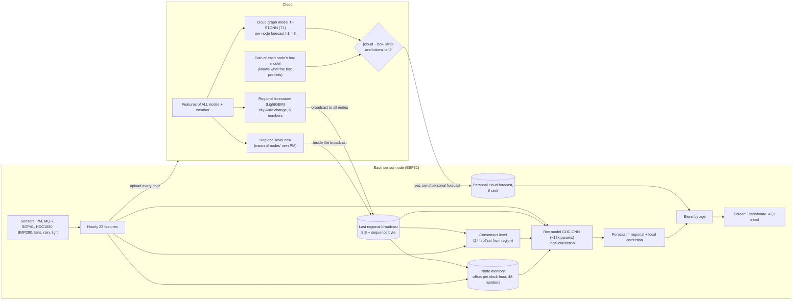

# Architecture v3: a node-network AQI forecaster for Delhi

**Cloud graph model + regional broadcast + on-device local model with node memory**

Version 3, 17 Nov 2026. This file explains the **whole system end to end** for someone who has never seen the
project: what the sensor nodes are, what the cloud does, what runs on the box, how everything was trained and
tested, what is new, what failed, and what comes next. Plain words first, formulas after. It replaces
`docs/ARCH_V2.md` (kept for history).

> **Status, read this first.** Every number here comes from **simulated sensor boxes** (`simulator.py`) driven by
> real CPCB station data (Jan 2018 - Sep 2026) and real ERA5 weather. No real box has been deployed yet. The numbers
> show the design is worth building; they are not final paper results. Full experiment log with every table:
> `docs/EXPERIMENTS.md`.

**What changed from v2 to v3**

| | v2 (15 Nov) | v3 (17 Nov) |
|---|---|---|
| box model | split-res (regional forecast + local correction) | split-res **+ consensus level + node memory** (new, E8) |
| best box skill (seen / new places) | 17.7 / 19.9 | **18.9 / 21.1** (box alone: 16.0 / 17.5) |
| link-failure behaviour | claimed "no-regret" | **corrected**: proven only for a 1-byte level. The full split model trained for stale links loses most of its fresh gain and is harmed by a missing broadcast (E9). Planned fix: two models on the box. |
| training data for the box | 200k windows | 1 M windows gives a further −1.06 % RMSE; a wider model gives nothing (E10). The final run will use ≥ 1 M. |
| send rule | disagreement rule | unchanged: a learned rule was tested and is not better (E7) |
| buffered +9 h broadcast | idea | tested, **fails** (E9) |

---

## 0. The idea in one minute

- We put low-cost sensor boxes (ESP32 + PM, gas and weather sensors) around Delhi. Each box forecasts how PM2.5 and
  PM10, and so the CPCB AQI, will **change** in the next 1, 2 and 3 hours.
- **What v3 is, honestly:** a **cloud-assisted on-device forecaster**. It is NOT a model that copies a big model into
  a small one. The cloud and the box run **different models on different inputs**: the cloud forecasts the shared
  city-wide change (from all boxes), the box forecasts its own place (from its own sensors plus what the cloud sent).
- **Why not copy the big model into the box (v1 attempt):** the big cloud graph model scores 20.8 against the box
  model's 15.0 because it **sees the other nodes**. Training the box model to match it added only +0.9, since the box
  cannot see what the cloud sees. So v2 sends that network information to the box as a **live input** instead.
- **v2:** the cloud uses all nodes to forecast the **shared, city-wide change** and broadcasts it in **8 bytes**.
  The box predicts only **its own local difference** on top of it.
- **v3:** the box also keeps a small **memory of its own habits**: for every clock hour, how far it usually sits
  above or below the city. This tells the model "how unusual am I right now" and "how my offset usually moves in
  the next hours". It costs 0 bytes on the link and 48 numbers in flash.
- When the cloud and the box disagree strongly, the cloud also sends that box its **personal** graph forecast.
  About 20 % of the messages keep about 2/3 of the gain.
- Result on simulated nodes: the on-device forecast goes from skill **16.0 → 18.9** at known places and
  **17.5 → 21.1** at **new places** (about −3.4 % and −4.3 % RMSE).

---

## 1. Problem and goal

| | |
|---|---|
| **Forecast** | change of PM2.5 and PM10 at +1, +2, +3 h for each box (the cloud graph model does +1..+6 h) |
| **Target** | `y = ln(1+PM[t+h]) − ln(1+PM[t])` of the **true** CPCB PM; output order `[pm25_h1..h3, pm10_h1..h3]` |
| **Why the change, not the level** | the box's own PM sensor is biased (humidity, calibration). The change is easier to learn; the level comes from the calibrated sensor or the cloud. |
| **Score** | **skill** = `1 − RMSE / RMSE(persistence)` in %, persistence = "PM stays the same". 0 = no better than the lazy guess. Also direction accuracy (up / down right) and CPCB category accuracy. |
| **Where** | Delhi-NCR, 32 CPCB stations used as node places: 27 for training, **5 never seen** (new places) |
| **When** | train 2018-2023, validation 2024, test Jan 2025 - Sep 2026 (time split, no leakage) |
| **Comparison test** | 95 % week-block paired bootstrap of the RMSE change. If the CI contains 0, there is no real difference. |

**Research question:** how much better can a tiny on-device forecaster get when the nodes share a few bytes per hour
through the cloud and each node remembers its own habits, and how should it behave when the link fails?

---

## 2. The whole system at a glance



Without Mermaid:

```
 node i: sensors -> 23 features --upload--> CLOUD: all nodes + weather
                                              |-> cloud graph model T1 (per node, h1..h6)
                                              |-> regional forecaster (6 numbers, same for all)
                                              |-> regional level now (2 numbers)
          <-- 8-byte broadcast + 1 sequence byte (every hour, to everyone) --|
          <-- personal forecast (only when cloud and box disagree) ---------|
 node i: consensus level  = region + my usual 24 h offset
         node memory      = my usual offset at each clock hour (48 numbers)
         box model(own 24 h + ctx + broadcast + consensus + memory) = regional + local correction
         show: fresh personal forecast > blend(stale personal, box) > box
```

### 2.1 Data flow and tensor shapes (one hour, step by step)

Shapes are per node unless written `[N, …]` (N = 27 nodes in training, 32 at test). Numbers come from
`notebooks/04_train.ipynb` (cloud graph model, box model) and `experiments/exp_split.py`, `exp_memory.py` (v2 / v3 parts).

**① On the box: sensing**
- Each sensor is averaged over the IST clock hour → **23 features** `S_i(t)`: ln PM2.5 / PM10 / PM1, coarse ratio, T, RH,
  p, fan wind u / v, rain fraction, ln light, MQ-7 / MQ-135 / VOC / NOx (relative to clean-air baseline), hour /
  weekday / day-of-year as sin / cos, current AQI, PM-valid mask.
- The box keeps the last 24 hours → window `[24, 23]`.

**② Upload:** one record `[23]` per hour to the cloud. The cloud stacks all nodes → `X [N, 24, 23]` + mask `M`.

**③a Cloud: regional forecaster (LightGBM)**
- Regional level now: `R25(t) = mean_i S_i,ln_pm25(t)`, same for PM10 (nodes' own sensors, never true PM).
- Feature row for hour t, **36 numbers**: R25 and R10 at lags 0, 1, 2, 3, 6, 12, 23 h plus their 1-h and 3-h changes
  (2 × 9 = 18) · regional mean RH, T, MQ-7, fan u, fan v (5) · city-mean ERA5 now (7) · clock sin / cos of hour,
  day of year, weekday (6).
- **6 separate LightGBM models** (one per output; L2, 300 trees, 31 leaves, lr 0.05), out-of-fold over the 2-year blocks
  of the training years → `R̂ [6]` = city-mean change of ln PM, `[pm25 +1, +2, +3, pm10 +1, +2, +3]`.

**③b Cloud: graph model TI-STGNN (T1), d = 64**

| step | operation | output shape |
|---|---|---|
| input | 23 sensor + 7 ERA5 channels, z-scored, missing → 0, with mask; 6 static numbers per node | `X, M [N, 24, 30]`, `S [N, 6]` |
| embedding | `Linear([X·M, M] 60→64) + Linear(S 6→64)` + sine code of the hour position | `[N, 24, 64]` |
| temporal encoder | per node: 2 × Transformer layer (4 heads, FFN 256, pre-norm, dropout 0.1) → LayerNorm | `F [N, 24, 64]` |
| current state | last hour of F | `h_t [N, 64]` |
| spatial block (GAT) | `score_ij = LeakyReLU(a_r·W h_i + a_s·W h_j) + β·log prior_j→i`, prior = 1 / distance (T1); dead nodes masked; softmax over senders; `h_s = h_t + Linear(α · W h)` | `h_s [N, 64]` |
| ADR / wind prior | T2 / T3 ablations only; identity in T1 | `[N, 64]` |
| decoder | `z = GLU(Linear([h_s, h_t] 128→128))` → 64; queries `q_k = hourcode_k + Linear(x_fut 9→64) + z`, k = 1..6, with `x_fut` = ERA5 t+1..t+6 (7) + clock (2); one Transformer decoder layer cross-attending to F | `[N, 6, 64]` |
| heads | `Linear 64→2` (forecast) and `Linear 64→4` (distances to q10 / q90) | `ŷᵀ, q10, q90 [N, 12]` |

Loss: Huber(ŷᵀ, y) + 0.5 · pinball(q10, q90); AdamW 1e-3, batch 64, node dropout 0.1, T4 GPU.

**④ Broadcast:** `R̂ [6]` + `R25(t), R10(t)` as int8 = 8 bytes, + 1 sequence byte. On the box this becomes the
**broadcast input [8]** = `[3·R̂ (6), R25 − own25, R10 − own10]`.

**⑤ On the box: node state (no extra bytes)**
- Consensus `d = R + EWMA_24h(S − R)` → **[3]** = `[d − S, 3·Δ1h d, 3·Δ3h d]`.
- Memory table `M [24 clock hours, 2 pollutants]`, EWMA over 10 days of the offset `o = S − R` →
  **[8]** = surprise (2) + 3 × profile for h = 1..3 (6).

**⑥ On the box: box model GDC-CNN (width D = 32)**

| step | operation | output shape |
|---|---|---|
| instance norm | each feature minus its own 24-h mean, divided by its std (clock, rain, mask left as is); `s` = std of ln PM2.5 (×3) and ln PM10 (×3) | `[24, 23]`, `s [6]` |
| patches | 2 consecutive hours side by side | `[12, 46]` |
| embedding | `Dense 46→32` + learned position code | `[12, 32]` |
| 3 GDC blocks | dilation 1, 2, 4: LayerNorm → causal depthwise conv k = 3 → `Dense 64` + GLU → `Dense 32`, residual add | `[12, 32]` |
| flatten | | `[384]` |
| side branches | each `Dense 32` + GELU: ctx [9] (ln PM2.5, RH, T, MQ-7, 4 clock / season, wind speed), broadcast [8], consensus [3], memory [8] | 4 × `[32]` |
| join + head | concat `[512]` → `Dense 512→6` → × s | local correction `s·c [6]` |

**⑦ Combine:** `ŷ_i = R̂ + s · c` → `[6]`, the predicted change of ln(1+PM) for `[pm25 +1..+3, pm10 +1..+3]`.
Shown PM = `exp(ln(1+PM_now) + ŷ) − 1`, then CPCB AQI.

**⑧ Screen:** fresh personal forecast → cloud; 1-3 h old → fixed blend; else `ŷ_i` (Section 6.6).

**⑨ Trigger:** the cloud runs the twin box model on the same uploads → `ŷ^twin [6]`; if `|ŷᵀ(+1..3) − ŷ^twin|` is in the
top 20 % and tokens remain → personal forecast `[6]` as int16 = 12 bytes.

---

## 3. The nodes

### 3.1 Hardware (fixed sensor pool)

| part | measures | used for | value (simulated) |
|---|---|---|---|
| ESP32-WROOM-32 DevKit 38-pin now (ESP32-S3 later) | runs the box model, Wi-Fi | model + upload | |
| PMS7003 now / SPS30 later | PM1, PM2.5, PM10 | main signal | essential |
| MQ-7 | CO (traffic) | context | **best extra sensor** (−0.45 skill if removed) |
| 2 perpendicular fans + hall sensors | wind speed along 2 axes (speed only) | local mixing | **useful** (−0.26) |
| SGP41 | VOC / NOx index | context | small (−0.14) |
| BMP280 | pressure | context | small (−0.09) |
| HDC1080 | temperature, humidity | PM humidity correction, context | needed |
| rain plate 0/1, BH1750 light, MQ-135 | rain, light, air quality | context | ≈ 0 (MQ-135: +0.04 skill for ~0.8 W) |
| DS3231 | real-time clock | hour stamps | needed |

Power numbers are TODO_VERIFY. Sensor values come from the simulator, so they must be re-checked on real boxes.

### 3.2 What a node does every hour

1. Average its sensors over the hour → **23 features**: ln PM2.5 / PM10 / PM1, coarse ratio, T, RH, p, fan wind
   |u| / |v|, rain fraction, ln light, MQ-7 / MQ-135 / VOC / NOx (relative to their clean-air baseline),
   hour / weekday / day-of-year as sin / cos, current AQI, PM-valid mask. (Code: `firmware/aqi_node/features.h`,
   checked against the notebooks by `firmware/check_features.py`.)
2. **Upload** the hourly record to the cloud (if online).
3. **Receive** the hourly broadcast (if online): 6 regional forecasts + 2 regional levels + sequence byte.
4. **Update** its consensus offset (24 h EWMA) and its **memory table** for this clock hour (Section 6.4).
5. Run the box model on the last 24 h + context + broadcast + consensus + memory → forecast for +1..+3 h.
6. Show the best forecast available (Section 6.6).

### 3.3 Why the nodes are essential (not just "sensors for a cloud model")

| what the node gives | why the cloud cannot do it alone | evidence |
|---|---|---|
| **Its upload is the network.** The cloud's graph and regional forecast are built only from node features; there is no other PM input. | no nodes, no network | graph of other nodes: −2.6 % error for the cloud graph model (E1) |
| **Real-time local state** (own PM, CO, humidity, local wind) | a box's PM is often about 2× above or below the city average (traffic, burning, dust) | regional forecast alone: skill 11.1; + the box's local model: 17.7 (E6) |
| **Its own daily habits** (memory table) | site-specific, repeats at the same clock hours | +0.9 skill seen, +0.8 new places; another node's table gives only ~1/6 of that (E8) |
| **Works offline** | the cloud is unreachable in outages | box-alone model as fallback (Section 6.5) |
| **Its own forecast** tells the cloud when a personal message is worth sending | the cloud runs a twin of the box model | disagreement sending beats random by 3-4 skill points (E4) |
| **New places** | a new box gets the broadcast from day 1 | unseen stations gain the most: 17.5 → 21.1 |

The node-count effect (how many nodes the broadcast needs) is **not tested yet** (Section 12, E14).

---

## 4. Data, simulator and rules

### 4.1 Data
- **Truth:** official CPCB hourly files, 33 Delhi-NCR stations, Jan 2018 - Sep 2026; 32 used (one has no PM10).
  Cleaning: range limits, 6-h flat lines, Hampel filter. Times = IST clock hours; `ts` = UTC instant of the IST hour
  start.
- **Weather:** Open-Meteo ERA5 (temperature, humidity, pressure, wind u / v, rain, sunlight), requested in GMT.
- **Measured CPCB wind** (WS / WD) only for the wind re-test (`experiments/build_wind_cpcb.py`).

### 4.2 Simulator (no real boxes yet)
- `simulator.py`: `simulate(X, station, unit) -> Y` turns the true air + weather of a station into what one ESP32 box
  would read, one physics / datasheet function per sensor (explained in `notebooks/02_simulator.ipynb`).
- **3 virtual units per station** (96 boxes), each with its own bias, gain, drift, missing hours and outages.
- The simulated PMS7003 has slope 2.19 vs truth and R² 0.61 (TODO_VERIFY by co-location).

### 4.3 Hard rules (research correctness)
1. **True CPCB PM is a target only, never an input.** Cloud graph model, regional forecaster and box model all get only
   simulated node features (+ weather for the cloud). So broadcasting (and the optional cloud matching) move *network knowledge*,
   not "clean data".
2. **No future leakage.** Inputs use hours ≤ t. Anything one model makes for another model's training (cloud graph model
   outputs, regional forecasts) is **out-of-fold**. The memory entry used for hour t+h was last updated at t+h−24.
3. The 5 hold-out stations are never trained on.

---

## 5. The cloud side

### 5.1 Cloud graph model TI-STGNN

**What:** a PyTorch model (~0.2 M parameters) that sees all nodes' last 24 h and forecasts each node's change at
+1..+6 h, with a 10-90 % band.

**Blocks:**
1. **Transformer over time**, per station, over the 24 h × 23 features.
2. **Graph attention (GAT)** between stations, optionally with a wind prior
   `prior(j→i) = ReLU(ws · cos(bearing_ji − wind_to)) / dist_ji`, used as `β · log(prior)` (direction the wind
   blows TO, edge from the neighbour: a fix of the TransNet prior).
3. **ADR physics block** (advection on attention scores, mass-conserving; exact diffusion on a distance graph;
   small reaction network; step 0.1, 2 steps).
4. **Decoder** with the next 6 h of weather. This is a **hindcast** (ERA5 actuals), because archived forecasts don't
   exist for 2018-23.

**Variants:** T0 (own station), T1 (+graph), T2 (+wind prior), T3 (+ADR).
**What survived:** only the **graph** (−2.6 %). Wind prior and ADR equal a placebo.
**Decision:** the live cloud uses **T1**. T2 / T3 stay in the paper as negative results.
**Roles in v3:** (a) personal forecasts for the trigger (5.4), (b) extra targets for cloud matching (7), (c) a
possible alternative regional source (mean of its per-node forecasts; not yet compared).

### 5.2 Regional forecaster

**What:** one small model for the whole city that forecasts the **city-wide mean change** of PM2.5 and PM10 at
+1..+3 h (6 numbers), the same for every node.

**Inputs (hour t and before, nodes + public weather only):**
- regional mean of the nodes' own ln PM2.5 / PM10, `R(t) = mean_i S_i(t)`, at lags 0, 1, 2, 3, 6, 12, 23 h, plus its
  1-h and 3-h changes;
- regional means of the nodes' RH, T, MQ-7 and fan wind;
- city-mean ERA5 weather now (7 channels; no future weather); clock (hour, weekday, day of year as sin / cos).

**Target:** mean over nodes of the true change (target only).
**Model:** LightGBM, 6 outputs, **out-of-fold over year blocks** (2018-19, 2020-21, 2022-23), so the box model is
trained on regional forecasts that never saw those hours.

**Why it works:** Delhi behaves as **one airshed**. Clustering stations by the correlation of their 3-h changes gives
one cluster of 28 stations + 4 singletons (correlation within 0.33, between 0.10). Averaging many noisy boxes
cancels each box's sensor noise, so the city-wide change is easy for the cloud and hard for any single box.

### 5.3 Regional level (for the consensus filter and the memory)

The cloud also sends the **regional level now**, `R25(t)` and `R10(t)` (mean of the nodes' own ln PM). The box
uses it for the consensus filter (6.3) and the node memory (6.4). It is 2 of the 8 broadcast bytes.

### 5.4 Personal forecasts with event-triggered sending

The cloud keeps a **twin** of each node's box model and runs it on the uploaded features, so it knows the box's
forecast without asking ("dual prediction" from sensor networks). Each hour it sends a node its personal T1
forecast **only if**:
- the disagreement `|cloud − box|` is among the largest (send-on-delta), and
- the node still has tokens left (**token bucket**: a fixed number of messages per node per day).

Result: at 20 % of hours it keeps ~66 % of the gain (random sending: ~19 %); 4-6 messages per day give most of the
benefit. A **learned** send rule (LightGBM predicting the benefit) was tested and gains only +0.16 skill (E7), so
the simple disagreement rule stays.

### 5.5 Message budget

| message | direction | size | when |
|---|---|---|---|
| hourly feature record | node → cloud | the 23 features | every hour (if online) |
| **regional broadcast** | cloud → all nodes | **8 bytes**: 6 regional forecasts (int8) + 2 regional levels (int8); + 1 sequence byte so the box knows its age | every hour, one message for everyone |
| personal forecast | cloud → one node | 12 bytes (6 × int16), + band if wanted | only when triggered (≈ 4-6 per day) |

8-bit levels were tested and equal float (E5). 8-bit quantisation of the 6 forecasts is **not tested yet** (E11).
The node memory and the consensus filter add **0 bytes**: the box computes them from its own PM and the broadcast
level.

---

## 6. The edge side (the box)

### 6.1 Box model network: GDC-CNN

- Based on Na et al.: the last 24 h are cut into **12 patches of 2 h**, with **instance normalisation** (the
  window's own level and scale are removed and kept as `s`), a position code, and **3 gated dilated depthwise
  convolution blocks** (dilation 1, 2, 4), width 32.
- **ctx input:** the raw current values that instance norm throws away (ln PM2.5, RH, T, MQ-7, hour, season, wind
  speed) go in through a small dense layer (−0.49 %, E3).
- About **15k parameters** (+ ~300 for the side inputs), Keras → TFLite FP32, a few tens of KB. It runs once an
  hour. Width 64 (48k parameters) gives nothing more (E10), so 15k is enough for the ESP32.

### 6.2 Split output: regional + local correction

```
inputs : own 24 h (12 patches) + ctx
         + broadcast  [R̂_1..6 (6 forecasts), R25(t) − own25(t), R10(t) − own10(t)]       (8 numbers)
         + consensus  [d − S for PM2.5, 1 h and 3 h slopes of d]                           (3 numbers)
         + memory     [surprise ×2, profile ×6]                                            (8 numbers)
body   : GDC-CNN as before; each side input through its own small dense layer, joined before the head
output : ŷ = R̂ + s · Dense6(features)        # regional forecast + the box's local correction
```

- `R̂` = the 6 regional forecasts from the broadcast; `s` = the instance-norm scale.
- The box learns **only the local difference**, so its few parameters go to what only it can see. Same idea as
  **common-mode rejection** in electronics: subtract what everyone shares, amplify only what is yours.
- Honest note: most of the gain comes from giving the box the broadcast at all (−1.43 %); the explicit residual form
  adds −0.16 % (not significant alone). It is kept for interpretability, but see 6.5: it makes a **missing**
  broadcast harmful.

### 6.3 Consensus level (from sensor-network consensus)

The box's level is re-estimated as "the region now + this node's usual offset":

`d_i(t) = R(t) + EWMA_{half-life 24 h}( S_i − R )(t−1)`

This removes short sensor noise but keeps the persistent local offset. Alone it gives −0.90 %; on top of split-res
it adds −0.27 % seen / −0.44 % new places (E8, "b0").

### 6.4 Node memory (NEW in v3)

**In plain words:** the box keeps a table with, for each of the 24 clock hours, how far its PM usually sits above or
below the city. Traffic peaks and evening burning repeat every day at the same hours and differ from site to site.
The consensus filter (one 24 h average offset) cannot see that; the memory can.

**Formulas** (separately for PM2.5 and PM10):
- offset now: `o_i(t) = own ln PM_i(t) − R(t)` (R from the broadcast; no true PM)
- memory: `M_i(c)` = EWMA over past **days** (half-life 10 days) of `o_i` at clock hour c → 24 × 2 = **48 numbers**
- **surprise** = `o_i(t) − M_i(clock t)`: "how unusual am I right now" (2 inputs)
- **profile** = `M_i(clock t+h) − M_i(clock t)`, h = 1, 2, 3: "how my offset usually moves next" (6 inputs, ×3 scale)
- the entry for hour t+h was last updated at t+h−24, so no future data is used. Hours with no broadcast leave the
  table unchanged (EWMA ignores missing values).

**Result (E8, 3 seeds):**

| box model | skill seen | skill new places | % RMSE vs previous row (CI) |
|---|---|---|---|
| split-res + consensus (b0) | 17.97 | 20.29 | |
| + surprise only | 18.24 | 20.74 | −0.38 / −0.61 |
| + profile only | 18.46 | 20.56 | −0.56 / −0.29 |
| **+ both (mem)** | **18.90** | **21.06** | **−1.09 (−1.27 to −0.91) / −0.89 (−1.07 to −0.70)** |
| + another node's table (placebo) | 18.03 | 20.31 | −0.17 / −0.12 |

mem vs placebo: −0.92 % seen, −0.77 % new places (CIs exclude 0). So the gain is **site-specific**, not just "more
inputs". Pre-registered kill threshold (−0.3 %, CI excluding 0, beat the placebo): **passed**.

**Cost:** 0 bytes on the link, 48 floats in flash, ~300 parameters, a few multiplications per hour.

### 6.5 Robustness: stale and missing broadcasts (corrected in v3)

What is known:
- **1-byte regional level** (E5), trained with 0-3 h old / 20 % missing context: fresh −0.71 %, 1 h old −0.20 %,
  2-3 h old or missing within ±0.1 % of no broadcast. So a **level-only** broadcast is no-regret.
- **Full split-res model** (E9), trained with random age 0-6 h and 15 % missing:
  - fresh it scores only 16.19 (short +1..+3 h) / 16.68 (long +1..+9 h path), against 17.73 for the same model
    trained with a fresh broadcast: **most of the fresh gain is lost**;
  - a **missing** broadcast makes it **worse** than no broadcast model at all (+1.0 % seen, +1.4 % new places for the
    long path), because the residual output sets `R̂ = 0` and the correction must suddenly produce the whole change;
  - a +9 h path ("send the plan, not the next step") beats +3 h at ages 0-3 h on new places, but at 3 h it keeps
    almost nothing over the box alone (kill threshold **failed**).

**v3 design rule (planned, E12):** keep **two models on the box** (flash allows it: 2 × ~60 KB):
1. the split + consensus + memory model, trained with a fresh broadcast, used while the broadcast is ≤ 1 h old;
2. the ctx box model (box alone), used when the broadcast is older or missing.

E12 also compares this with one model trained on mostly fresh ages (70 % fresh, 15 % 1-2 h, 15 % missing). Until
E12 runs, **the split model is not claimed to be no-regret.**

### 6.6 What the screen shows (fusion rule)

| situation | shown forecast | skill (test, unit 0) |
|---|---|---|
| fresh personal cloud forecast (age 0) | cloud | 23.5 |
| personal forecast 1 h old | fixed blend α·cloud + (1−α)·box, α = 0.52 | 19.4 |
| 2 h old | blend, α = 0.41 | 18.3 |
| 3 h old | blend, α = 0.36 | 17.8 |
| no personal forecast | box model (6.2-6.5) | 16.0 - 18.9 |

- **Re-basing rule:** an old forecast is moved to "now" along **its own forecast path**
  (`old_forecast − old_forecast[age]`), **never** with the box's noisy current sensor reading (that gave −71 % skill).
- α is fixed per age, fitted on 2024. Online-adaptive weights (Bates-Granger, Jacobson / TCP-RTT style) are not
  better.

### 6.7 What the box still needs before deployment

- **Co-location calibration** of the PM level: with the uncalibrated sensor the AQI colour is right only 43 % of
  the time (71 % from the true level). Set `PM_CALIBRATION` in `firmware/aqi_node/aqi_node.h` after 2-4 weeks next
  to a CPCB station.
- Firmware: receive the broadcast in `cloud.cpp`, compute consensus and memory in `features.h`, hold two models.
  **Not built yet.**

---

## 7. Training pipeline

| step | where | what |
|---|---|---|
| `notebooks/01_data` | laptop | CPCB + Open-Meteo → clean hourly tables |
| `notebooks/02_simulator` | laptop | `simulator.py`: 3 virtual boxes per station |
| `notebooks/03_dataset` | laptop | 23 features, targets, windows, graph grids `grid_u{0,1,2}.npz` |
| `notebooks/04_train` Part A | Kaggle GPU (`aqi-train`) | cloud graph model T0-T3, ablations, **out-of-fold** cloud graph model outputs |
| `notebooks/04_train` Part B | Kaggle GPU (`aqi-train`) | box model S0-S4 (cloud matching), sensor ablation, TFLite export |
| v2 / v3 additions | Kaggle CPU / GPU (`aqi-exp-*`) | regional forecaster (OOF), consensus, memory, split box model, fusion, trigger |

- **The box model is trained on its own true targets plus the broadcast inputs.** It is not a copy of the cloud model:
  the two models see different inputs and predict different things (city-wide change vs the box's own change).
- **Cloud matching is optional and not part of the v3 result.** In v1, adding "match the cloud graph model's forecast
  (+ its time features / attention)" to the box model's training gave +0.9 skill. Whether it still adds anything on
  top of the broadcast is untested (E11); if it does not, it is dropped.
- **Training size:** the box models so far used 200 000 of 2.6 M training windows. 1 M windows gives −1.06 % RMSE
  seen and −0.77 % new places (E10). The final models will use ≥ 1 M windows.
- Laptop only for data and smoke tests; all training on Kaggle (`kaggle/kaggle_run.py`, `experiments/kaggle_exp.py`).

---

## 8. Novelty: what is new and how strongly we can claim it

### 8.1 From v1

| # | idea | status |
|---|---|---|
| v1-1 | Cloud graph model → MCU box model trained to match its forecasts (TI-STGNN → GDC-CNN) | works but small (+0.9 skill; keeps 12-24 % of the cloud graph model's lead). A baseline / training method, not the headline. |
| v1-2 | **Fair cloud matching**: identical simulated features for cloud graph model and box model, true PM only as target | **kept**: the gain is network knowledge, not cleaner data |
| v1-3 | Wind-direction fix of the TransNet prior | correct physics, no measurable gain → negative result |
| v1-4 | ADR physics block | ≤ 0.2 % → negative result |
| v1-5 | Making the box model match the cloud's spatial / physics states | **hurts** → negative result |

### 8.2 From v2

| # | idea | result | claim |
|---|---|---|---|
| **N1** | **Split cloud-edge forecaster**: cloud broadcasts the city-wide change (8 B), box predicts only its local difference | −1.58 % (CI −1.90 to −1.27); skill 16.0 → 17.7, new places 17.5 → 19.9 | **main contribution** |
| N2 | Consensus level | −0.90 % alone; −0.27 % on top of N1 | supporting |
| N3 | Byte-level regional context (1 byte, 8-bit = float), staleness / dropout training | −0.71 % fresh, no-regret for a level-only byte | supporting (scope corrected in v3) |
| N4 | Event-triggered personal forecasts + box model twin + token bucket | at 20 % of hours ~66 % of the gain | supporting: bandwidth-accuracy curve |
| N5 | Stale-forecast re-basing on its own path + fixed blend by age | sensor re-base −71 %; path re-base 19.4 at 1 h | small design rule |
| N6 | Placebo-controlled wind test | wind direction = 180° placebo | honest negative result |
| N7 | Sensor value per watt (all 128 subsets) | fans + MQ-7 worth it; MQ-135 ≈ 0 for ~0.8 W | design rule |

### 8.3 New in v3

| # | idea | result | claim |
|---|---|---|---|
| **N8** | **Node memory**: per-clock-hour table of the node's offset from the regional broadcast; surprise + profile inputs; 0 link bytes | −1.09 % seen / −0.89 % new places on top of N1 + N2; placebo (another node's table) gets ~1/6 | **second component of the main claim**: the cloud gives the common part, the node remembers its own habits |
| N9 | **The price of robustness** (E5 vs E9): a level-only byte is no-regret; the full split model trained for stale links loses most of its fresh gain, and the residual output makes a missing broadcast harmful | +1.0 / +1.4 % worse when missing | design lesson; becomes a positive rule if E12 (two models) works |
| N10 | **Learned send rule is not needed** (E7) | +0.16 skill vs +0.5 required | negative result strengthening N4 |
| — | Data before size (E10) | 1 M windows −1.06 %; width 64 = 0 | a method fix, not novelty |

**The paper sentence (v3):** *"A split cloud-edge forecaster for low-cost air-quality nodes: the cloud uses all nodes
to predict the shared regional change in 8 bytes, and the on-device model predicts only the local difference, helped
by a small memory of the node's own daily habits. On simulated nodes in Delhi this improves the on-device forecast by
about 3.4 % RMSE at known sites and 4.3 % at new sites, and a disagreement-triggered personal forecast recovers two
thirds of the full cloud model's gain at one fifth of the messages."*

(The 3.4 % / 4.3 % are derived from skills on the same test windows; E11 gives the direct bootstrap CI.)

### 8.4 What we do NOT claim

- "Global model + local residual" in general (hierarchical forecasting, MOS corrections exist). Our delta:
  low-cost AQI nodes, a byte-sized broadcast, an MCU model, node memory, measured link-failure behaviour, Delhi
  evaluation at seen and new sites.
- Dual prediction, send-on-delta, consensus filters, gossip, token bucket, forecast combination, anomaly /
  climatology features: all known; we **apply and measure** them.
- Cloud context sent to an edge model exists in other domains (e.g. cloud-assisted edge PV forecasting;
  collaborative edge learning for air pollution, Wardana et al. 2024, to verify).
- "No-regret" for the full split model (not shown; E9 shows the opposite so far).
- Wind / ADR / fuzzy / custom losses as improvements.
- **No "first" wording before a literature check.**

---

## 9. Evidence (simulated nodes, test Jan 2025 - Sep 2026)

% error = RMSE change vs the reference (negative = better); CI = 95 % week-block paired bootstrap. Skills are means
over 3 seeds unless noted. Compare numbers within a table. E6, E8, E9 and E10 share the same box model test windows.

### 9.1 Cloud graph model (E1, `aqi-exp-wind`, GPU)

| cloud graph model | skill 1-6 h (seen) |
|---|---|
| T0 own station, no weather | 22.82 |
| T0 + future weather (hindcast) | 23.99 |
| **T1 + graph** | **25.97** |
| T2 + ERA5 wind | 26.11 |
| T2 + measured CPCB wind | 26.00 |
| T2 + wind rotated 180° (placebo) | 25.95 |

Graph vs no graph −2.60 % (CI −2.93 to −2.27); future weather −1.27 %; ERA5 wind vs placebo −0.21 % (CI −0.43 to
+0.01); measured wind −0.04 %. LightGBM probe (E2): distance-weighted neighbours −1.0 % at +1 h, upwind = downwind.

### 9.2 Box alone (E3, `aqi-exp-student`)

| box model | skill seen | skill new |
|---|---|---|
| S0 | 15.64 | 17.16 |
| **S0 + ctx** | **16.02** | **17.49** |
| fuzzy TSK gate | 15.89 | 17.34 |
| + weather forecast | 14.85 | 16.52 |

### 9.3 The box-model stack (E6 `aqi-exp-split`, E8 `aqi-exp-memory`)

| box model | skill seen | skill new | direction acc. | % RMSE (CI) |
|---|---|---|---|---|
| regional forecast only, no box model | 11.06 | 14.44 | 67.3 % | |
| ctx (box alone) | 16.01 | 17.48 | 69.8 % | reference |
| + consensus only | 16.83 | 18.56 | 70.4 % | −0.90 vs ctx |
| + broadcast as input (split) | 17.46 | 19.34 | 71.0 % | −1.43 vs ctx |
| + residual output (split-res) | 17.73 | 19.92 | 71.3 % | −1.58 (−1.90 to −1.27) vs ctx |
| + consensus (b0) | 17.97 | 20.29 | 71.4 % | −0.27 (−0.35 to −0.19) vs split-res |
| **+ node memory (mem)** | **18.90** | **21.06** | **71.9 %** | **−1.09 (−1.27 to −0.91) vs b0** |
| custom trend loss | 15.62 | 16.93 | 69.6 % | +0.64 vs ctx (worse) |
| custom AQI loss | 15.59 | 16.97 | 69.6 % | +0.38 vs ctx (worse) |

### 9.4 Training size (E10, `aqi-exp-moredata`, GPU, 2 seeds; ctx box model)

| training set | skill seen | skill new | params |
|---|---|---|---|
| 200k windows | 15.96 | 17.46 | 14 790 |
| **1 M windows** | **16.82** | **18.07** | 14 790 |
| 1 M, width 64 | 16.58 | 17.97 | 48 006 |

1 M vs 200k: −1.06 % (CI −1.30 to −0.81) seen, −0.77 % new. Width 64 vs 32: no difference.

### 9.5 Broadcast age (E5 `aqi-exp-netctx`, E9 `aqi-exp-buffer`)

1-byte regional level vs ctx (E5): fresh −0.71 %, 1 h −0.20 %, 2 h +0.01 %, 3 h +0.09 %, missing +0.10 %.
Gossip instead of cloud: about half the gain.

Full split-res trained with age 0-6 h and 15 % missing (E9), skill seen (ctx = 16.01):

| broadcast | age 0 | 1 h | 2 h | 3 h | 6 h | missing |
|---|---|---|---|---|---|---|
| +1..+3 h | 16.19 | 15.82 | 15.98 | 16.01 | 15.99 | 16.00 |
| +1..+9 h path | 16.68 | 16.19 | 16.12 | 15.99 | 15.73 | **15.42** |

New places (ctx = 17.48): +1..+9 h path 18.59 fresh, 17.72 at 3 h, **16.59 missing**.

### 9.6 Messaging (E4 fusion, E7 `aqi-exp-trigger`)

Box alone 15.66; personal cloud forecast every hour 23.30.

| % of hours sent | disagreement | random | oracle |
|---|---|---|---|
| 5 | 18.10 | 16.01 | 21.68 |
| 10 | 19.31 | 16.42 | 24.25 |
| **20** | **20.72** | 17.10 | 27.19 |
| 50 | 22.63 | 19.41 | 30.01 |

Token bucket, disagreement (per node per day): 1 → 16.51, 2 → 17.33, 4 → 18.26, 6 → 19.02, 12 → 20.86.
Learned rule vs disagreement at 20 % (second half of test): 21.12 vs 20.97, −0.20 % (CI −0.34 to −0.05).

### 9.7 Sensors vs power (E2, LightGBM, all 128 subsets; power TODO_VERIFY)

| best set at this power | W | skill |
|---|---|---|
| core (PM + T/RH + clock) | 0.55 | 17.74 |
| + fans | 0.56 | 18.42 |
| + fans, BMP280, SGP41, rain, light | 0.58 | 18.84 |
| + MQ-7 | 0.93 | 19.17 |
| + MQ-135 | 1.73 | 19.22 |

---

## 10. Negative results (report them)

| tried | result | our reading |
|---|---|---|
| wind direction in the graph (ERA5, measured, DE-tuned kernel) | = 180° placebo | Section 11 |
| ADR physics block | ≤ 0.2 % | the graph learns "who matters" from data |
| matching the cloud's spatial / physics states | worse | the box can't imitate what it can't see |
| fuzzy Takagi-Sugeno gate | = ctx | value is interpretability only |
| weather inputs on the box | no gain or worse | own T / RH / fans carry it; ERA5 is coarse |
| custom trend / AQI-breakpoint losses | +0.4 to +0.6 % worse | they pull away from the scored error |
| online blend weights | = fixed when stale, worse fresh | jumpy error estimates from noisy sensors |
| re-basing stale forecasts on the sensor | −71 % skill | sensor noise > forecast signal at 1 h |
| gossip instead of the cloud | half the gain | fallback only |
| per-cluster context | = city-wide | one airshed |
| learned send rule (E7) | +0.16 skill (needed +0.5) | the oracle gap is unpredictable luck |
| +9 h buffered path (E9) | stale ≥ 3 h ≈ no broadcast | regional change is not predictable far enough ahead to rescue a stale link |
| one model trained for all broadcast ages (E9) | loses most fresh gain; missing hurts | residual output + rarely-fresh training |
| wider box model (E10) | = width 32 | data-limited, not size-limited |

---

## 11. Why wind does not help

1. **Input too coarse:** ERA5 has only **4 distinct wind series for 32 stations** (median direction spread 4°).
2. **Measured wind too noisy:** CPCB vanes disagree by a median 70°; some stations have almost no wind data.
3. **The signal is mostly city-wide:** Delhi PM rises and falls together (night inversion, season, stubble smoke);
   the graph captures that without wind.
4. **Horizon too short:** stations are 5-15 km apart; at 0-2 m/s winter winds air needs 1-4 h to cross, and on calm
   nights (highest PM) it barely moves.
5. **Its information is already elsewhere:** wind **speed** is used (ERA5 u / v, the box's fans); calm air shows as
   rising PM and humidity at night.

Wind is not useless: it is already absorbed, and its **direction** adds nothing at this spacing and horizon. Denser
nodes (≤ 2 km) or longer horizons (6-24 h) may change this (idea 15 in `NOVELTY_IDEAS.md`).

---

## 12. Next steps (kill thresholds fixed now)

| step | what | keep / pass if |
|---|---|---|
| **E11** | Final combined model on 1 M windows: ctx vs split-res vs b0 vs mem (+ mem with cloud-matching targets; 8-bit regional forecasts; LightGBM vs mean-of-T1 regional source), 3 seeds, GPU | mem beats ctx by ≥ 3 % RMSE, CI excluding 0, seen and new places |
| **E12** | Two models on the box (fresh-trained mem model when broadcast ≤ 1 h old, ctx otherwise) vs one mostly-fresh-trained model | fresh within 0.2 % of the fresh-only model AND missing within +0.1 % of ctx |
| E13 | Fault robustness: stuck / spikes / +30 % drift / dead PM sensor for 6 h, 24 h, 7 d; virtual-sensor fallback from other nodes | mem loses less skill than ctx under faults |
| E14 | Node count: broadcast from 5, 10, 15, 27 nodes | at 10 nodes ≥ half the full gain |
| E15 | Severe-event recall / false alarms at CPCB "Poor"; calibrated 10-90 % band; forecast reconciliation (no training) | reporting |
| real | Co-locate 1-2 boxes with a CPCB station for 2-4 weeks: calibrate the level, check the simulator, re-test N1 + N8 on real data | most important for reviewers |
| build | Cloud endpoint in `backend/` (hourly upload, regional forecaster, T1 with live Open-Meteo forecasts, broadcast, twin trigger); firmware broadcast receive + consensus + memory + two models | |
| write | Literature check (hierarchical / residual forecasting with low-cost sensors, dual prediction, cloud-to-edge context for AQ), then the paper | no "first" before it |

---

## 13. Limitations

- **Simulated sensors**: the simulator decides how informative each sensor and node is.
- **Hindcast weather** for the cloud graph model (ERA5 actuals): live forecasts ~1 point worse, up to 3 at +6 h. The regional
  forecaster and the box use no future weather.
- **Nodes = CPCB station places** (5-15 km apart); a real network may be denser or sparser.
- **27 nodes** built the broadcast; fewer is untested (E14).
- **Not yet tested:** 8-bit regional forecasts, cloud matching on top of the broadcast, the two-model fallback, the stack on
  1 M windows, a direct mem-vs-ctx bootstrap (all E11 / E12).
- The memory and consensus use the box's own PM, so a faulty PM sensor affects them too (E13).
- The shown **level** still depends on co-location calibration.
- E7 was fitted and scored inside the test period (no 2024 forecasts saved). E10 used 2 seeds.

---

## 14. Glossary

| word | meaning |
|---|---|
| node / box | one ESP32 sensor unit |
| cloud graph model | the big cloud model TI-STGNN that sees all nodes; used for personal forecasts, not as a model the box copies (older drafts and some file names call it "teacher"; the box model is "student") |
| box model | the tiny model on the box (GDC-CNN) |
| cloud matching | training the box model to also match the cloud graph model's outputs |
| regional forecast / broadcast | the city-wide change for +1..+3 h (+ regional level), the same for all nodes, 8 bytes |
| local correction | what the box adds for its own place |
| consensus level | region now + the node's 24-h average offset |
| node memory | the node's usual offset from the region at each clock hour (48 numbers) |
| surprise / profile | how far the offset is from its usual value now / how it usually moves in the next 1-3 h |
| out-of-fold | a prediction from a model that never trained on that hour |
| skill | % better than "PM stays the same" |
| seen / new places | the 27 training stations / the 5 never used |
| placebo | the same input made meaningless on purpose (wind rotated 180°, another node's memory) |
| hindcast | a test using the real future weather instead of a forecast |
| token bucket | a fixed allowance of messages per day |
| twin | the cloud's copy of a node's box model, to know what the box predicts |
| gossip | boxes averaging values with neighbours directly, without the cloud |

---

## 15. Where everything is

| what | path |
|---|---|
| this design | `docs/ARCH_V3.md` (v2 kept as `docs/ARCH_V2.md`) |
| detailed figure with all shapes (appendix / Fig. 2) | `docs/arch_v3_detailed.drawio` |
| every experiment: hypothesis, method, result, Kaggle notebook | `docs/EXPERIMENTS.md` |
| ideas not yet run | `docs/NOVELTY_IDEAS.md` |
| v1 design / v1 results | `docs/DESIGN.md`, `docs/ABLATION_FINDINGS.md`, `docs/HOW_IT_WORKS.md` |
| main pipeline | `notebooks/01..04`, `simulator.py` |
| experiment code | `experiments/exp_<name>.py`; push / status / get: `experiments/kaggle_exp.py` |
| Kaggle notebooks (private, account `samiulseikh`) | `aqi-train` (v1), `aqi-exp-wind`, `-probe`, `-student`, `-teachpred`, `-netctx`, `-split`, `-trigger`, `-memory`, `-buffer`, `-moredata` |
| results | `data/5_models/kaggle/` (v1), `data/6_experiments/<name>/` |
| firmware | `firmware/aqi_node/` (`features.h`, `cloud.cpp`, `aqi_node.h`) |
